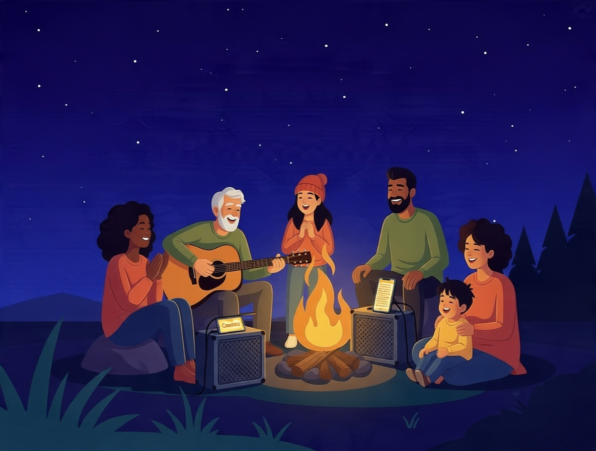
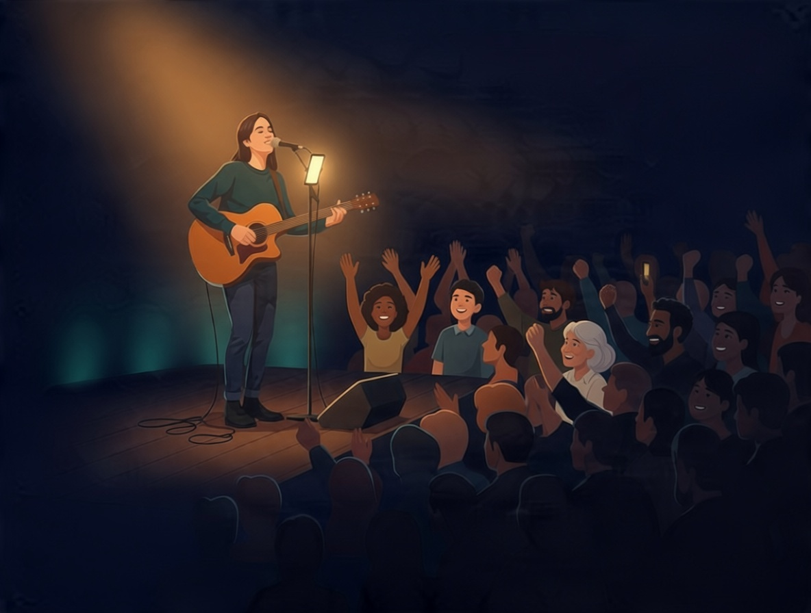
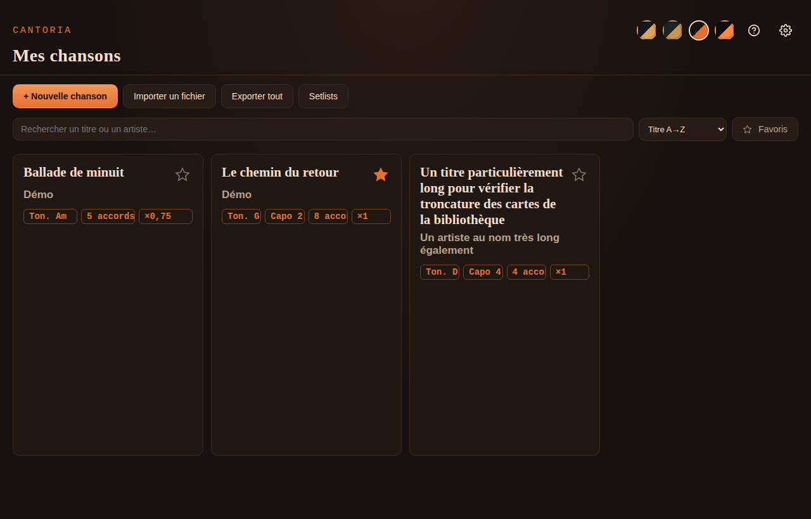
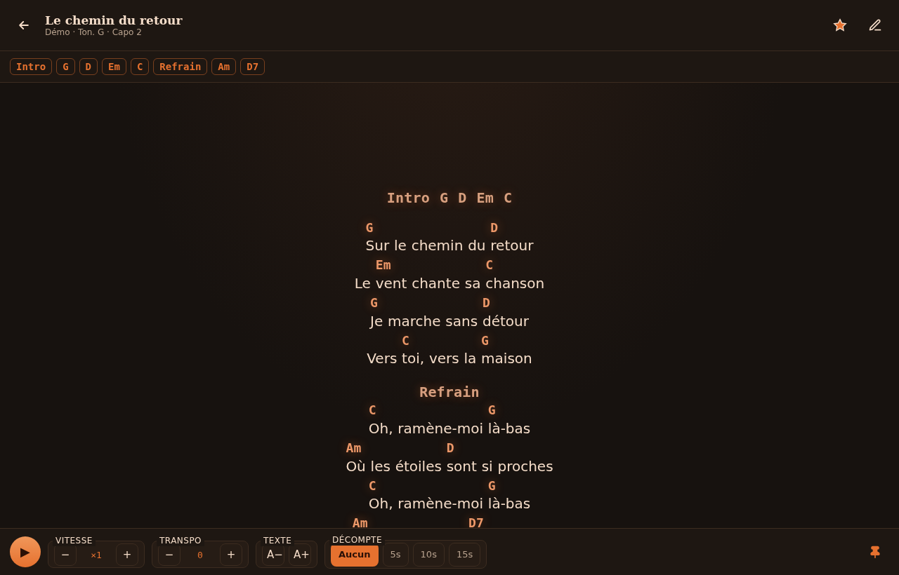
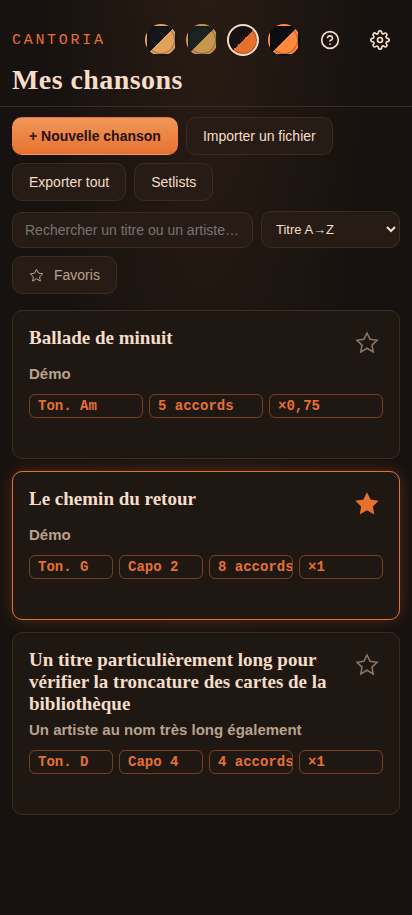
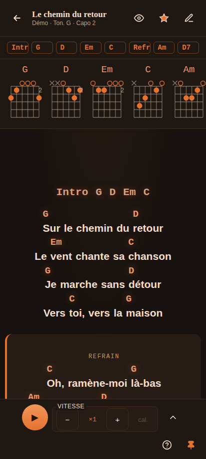

<div align="center">

# 🎸 Cantoria

**Le carnet de chants du guitariste — pensé pour la scène.**

Bibliothèque de chansons, lecteur à défilement automatique, transposition,
accords et diagrammes — 100 % hors-ligne, vos données restent chez vous.

[](https://github.com/Aris7Dev1/Cantoria/releases)
[](https://github.com/Aris7Dev1/Cantoria/releases)
[](./LICENSE)
[]()

</div>

<p align="center">
  
</p>

---

## Pourquoi Cantoria ?

Posé sur un pied de micro ou sur un ampli, le téléphone ou l'ordinateur
remplace le carnet papier : gros texte lisible à un mètre, défilement
automatique à vitesse réglable, transposition en deux taps, écran maintenu
allumé pendant la chanson. Et quand le morceau commence, plus rien à
toucher — l'app défile toute seule.

<p align="center">
  
</p>

## Pourquoi Cantoria plutôt qu'une autre app ?

Cantoria s'adresse au **guitariste-chanteur** qui veut un carnet simple,
privé et hors-ligne — pas un nouvel outil en ligne de plus. Sa différence
est une ligne assumée, pas une liste de fonctionnalités :

- **Zéro compte, zéro cloud, zéro télémétrie.** Vos chansons restent sur votre
  machine. Aucun suivi, aucune synchronisation tierce, aucun réseau côté
  interface.
- **Une seule dépendance runtime**, une interface en un seul fichier HTML sans
  framework ni bundler — du code lisible, auditable, durable.
- **Vos données sont exportables** (JSON complet, ou dossier de fichiers
  ChordPro `.cho`), importables à nouveau : vous ne dépendez pas de l'app.
- **Logiciel libre (MIT)** : vous pouvez lire, modifier et redistribuer le code.

Ce que Cantoria **ne cherche pas à faire** — par choix, pas par manque :
synchronisation avec un service tiers (Dropbox, Drive…) ni partage en ligne
de carnets. Si vous cherchez un carnet connecté, une autre application fera
probablement mieux : Cantoria vise uniquement le moment où vous jouez, les
mains occupées, sans rien d'autre à gérer.

## Fonctionnalités

- 📚 **Bibliothèque locale** : chansons au format ChordPro, favoris, recherche,
  tri, cartes avec tonalité/capo/accords utilisés
- 🎵 **Lecteur de scène** : défilement automatique (vitesse réglable ×0.1 à ×10),
  transposition ±, taille des paroles, navigation par section, décompte
  optionnel avant lecture
- 🎨 **Quatre thèmes sombres** pensés pour la scène : campfire, vibe,
  spotlight, guitar-case
- 📴 **100 % hors-ligne** : aucune dépendance, aucun compte, aucun réseau côté
  interface (seule exception : la vérification de mises à jour GitHub Releases,
  silencieuse hors ligne)
- 💾 **Vos données vous appartiennent** : stockage local + export/import JSON
  (bibliothèque complète), copie de secours automatique en cas de souci
- ⌨️ **Raccourcis clavier** (desktop) / **interface tactile** (mobile) : les
  indications s'adaptent au périphérique

## Téléchargements

Les installateurs et l'APK sont sur la page
[**Releases**](https://github.com/Aris7Dev1/Cantoria/releases) :

| Plateforme | Artefact |
|---|---|
| Windows | installateur `.exe` (x64 + arm64) |
| macOS | `.dmg` (Intel + Apple Silicon) |
| Linux | `.AppImage` + `.deb` (x64 + arm64) |
| Android / ChromeOS | `cantoria-<version>-android.apk` (sideload) |

## Captures d'écran

Thème **campfire**, desktop et Android :

<div align="center">
  
  
  <br>
  
  
</div>

Une présentation prête à projeter (deck HTML autonome) est disponible dans
[`docs/presentation/`](./docs/presentation).

## Développement

```bash
npm install
npm start        # lancer l'app desktop
npm run check    # vérification statique
npm test         # suite complète (~320 tests)
```

Structure du dépôt, décisions d'architecture et documentation dans
[`docs/`](./docs).

## Licence

[MIT](./LICENSE) © 2026 Aris7Dev1
